# 驗證報告

## IT AI 交接與本地整合試跑（2026-11-16，1.7.0）

新增可直接寄給 IT 的信、設定回覆表、AI agent 操作指引，以及 `SendModes-IT-AI-1.7.0.zip`。外層包含正式 runtime ZIP 與可重建／測試的 source；source 含原核可內部範本與聯絡資料，不能當成網站目錄。排除 `.env`、憑證私鑰、實際狀態資料、個人設定、舊郵件截圖與 repository memory。

本地入口 `npm run demo:company` 使用實際公司版 `dist/`、Node API、FileRepository 及 JWT 驗證器，搭配每次啟動重新產生的測試金鑰／身分與獨立 Office mock。僅綁定 `127.0.0.1`，正式 `server/index.mjs` 與 runtime ZIP 不含此模擬入口。

- `npm run test:company-local`：**2 項完整整合測試通過**。確認實際建置介面的必填預覽／插入、角色切換、Editor 儲存、Publisher 發布、Reader 看到新版；API 簽章、401／403、ETag 衝突、下架及磁碟儲存。模擬草稿原文、簽名、回覆歷史、To／CC／主旨保留，寄信次數 0、對外請求 0、JavaScript 錯誤 0，關閉後停止監聽。
- 重新執行公司建置、**145 項**單元測試、**12 項**後端、**5 項**匯入、**4 項**manifest 與 **29 項**瀏覽器 Office mock 測試，全部通過。
- 正式 runtime ZIP 在獨立目錄解壓後，`npm ci --omit=dev` 成功安裝 54 個執行依賴；使用產物初始化空私人庫並啟動真正 `server/index.mjs`。**20 項 HTTP 檢查通過**：頁面／資源／config／healthz 正常，未登入 catalog／admin 為 401，私人檔案／原始碼／demo 路徑為 404，狀態檔未被更改，測後已關閉服務。測試環境 Node.js 24.18.0。
- 修正原先 Windows ZIP entry 使用反斜線的問題；現在固定使用 `/` 相對路徑，可供不同系統解壓。正式包不包含測試登入或示範腳本。
- 完整 IT AI ZIP 另行解壓到新的獨立目錄，核對全部包內 SHA256，從 `source/` 執行 `npm ci`、`npm run build:company`、`npm run test:company-local` 全部成功；不是只測原工作資料夾。

操作與三張虛構資料截圖見 [本地測試](LOCAL-TEST.md) 及 `docs/evidence/local-demo/`。這些結果證明本地建置與應用程式流程可跑；**沒有完成真實 Entra 登入、SharePoint 租戶存取或 Windows／Mac Outlook 實機驗收**。沒有自動寄信。

## 公司集中範本與跨平台部署（2026-11-16，1.7.0）

完成 XML 共用工作窗格、公司 API、Entra 自訂 scope、讀取／編輯／發布角色、部門範圍、發布／下架／回復、樂觀版本控制、檔案／SharePoint REST 提供者。前端提供分類搜尋、變數填寫、HTML／純文字預覽及選擇性套用主旨；公司範本不寫入收件者。管理表單具有未儲存離開提醒；預覽後更新或下架停止草稿寫入。

本次自動化結果：

- TypeScript 檢查與 `npm run build:company` 通過；公司產物檢查舊範本預設收件者命中數為 **0**，不夾帶本機內建範本。
- `npm test`：**145 項**通過，包含個人模式、草稿完整性、純文字一次插入、預覽格式改變拒絕、公司版本檢查、Office 能力降級與登入快取在對話窗關閉前清理。
- `npm run test:server`：**12 項**通過，包含真正密碼簽章的測試 JWT、未授權存取、範本部門過濾、多人衝突、發布／下架／回復、檔案原子更新與 SharePoint HTTP 替身驗證。
- `npm run test:import`：**5 項**通過，既有四份範本轉成未發布草稿，沒有 To／CC／BCC，且同時通過後端與實際前端解析器。
- `npm run test:manifest`：**4 項**通過；Microsoft manifest validator 通過。
- `npm run test:e2e`：**29 項**通過，Chromium + Office.js mock。包含公司欄位、預覽、收件者與主旨保留、更新後零寫入、下架／載入失敗、管理表單、衝突保留編輯、發布確認、角色限制，以及既有個人模式與簽章回歸。320px 管理表單與公司預覽已目視檢查；截圖位於 `docs/evidence/company/`。

未完成的外部驗證：公司 HTTPS 主機、真實 Entra 登入／群組角色、SharePoint 憑證與文件庫 ETag、Microsoft 365 管理中心部署、Windows／Mac／網頁版新信及回覆／轉寄實機驗收。沒有在這次工作寄信、授予租戶權限或變更現有郵件。上述 mock 和 manifest validator **不能代替真實 Outlook 驗收**。

公司純文字模式為一次插入，不猜測舊文字區塊；公司範本圖片、一般附件、寄出前強制檢查及個人設定跨裝置同步未納入 1.7。部署設定與維護限制見 [公司服務](COMPANY-SERVICE.md)。

## 安裝卡住、登入恢復與表格編輯（2026-11-16，1.6.1）

使用者回報其他電腦執行 Setup 最後卡住、同事無法使用、重開機後不可用，以及套用後編輯表格跑版。未取得其他電腦的診斷紀錄，不把程式缺口直接當作所有電腦的已確認根因。

修正：啟動器移除無限輸出管線等待，安裝啟動上限 120 秒，其他服務動作上限 60 秒；自啟在服務啟動前登記，登入重試最多三次。健康檢查停用代理但保留 TLS 驗證。PowerShell 使用 Windows 內建模組路徑。提供診斷資料與連線測試入口，HTML 載入失敗及 React 錯誤保留可見修復提示。每台電腦仍需完整安裝。

模板 sanitizer 原先移除 `table-layout`，現保留並固定欄寬，以 colgroup 支援合併標題列下的欄寬；空格加入 br，長字串可換行。內部 CSS 使用每份模板獨有的類別而非外層 ID 選擇器，保留行內格式作為編輯後的備援。原始公司 HTML 與文字未改；不修改舊草稿的簽章／歷史。

- 單元測試：125 項通過，包含格式備援與原有草稿保護。
- Playwright：19 項通過，包含移除 style 後的長字串／儲存格換行，以及主程式無法下載時的修復提示。此為 Chromium + Office.js mock，**不是 Outlook 實機渲染**。
- Windows 安裝包無互動回歸：18 項通過。真正 EXE 解壓、真正 C# 啟動器在背景子程序存活時正常返回、失敗碼傳遞、埠衝突不終止其他程式、首次啟動失敗仍登記自啟、背景不建立新憑證信任、清理與解除安裝。測試使用隔離資料夾／Run 值與 3444 埠，不信任新憑證。
- TypeScript、正式前端建置、NSIS 封裝、Microsoft manifest 驗證通過。封裝工具顯式載入 Windows PowerShell Utility，避免 npm 環境中自動載入不到 Get-FileHash。

尚需在受影響電腦驗收：localhost 憑證信任、公司端點／WebView 存取、真實 Windows 登出登入或重開機，以及新 Outlook 內四種表格的打字、換行、貼上。未執行真實重新開機，未在其他電腦操作 Outlook，未寄信。若網址本身無法連線或憑證遭攔截，工作窗格頁面的載入提示也無法顯示，需使用 Windows 設定視窗診斷。

## Windows 安裝包（2026-11-15）

已產生 `release/SendModes-Setup-1.6.0.exe`（NSIS、x64、內附已驗證 OpenJS 簽章的 Node v24.18.0）。未替換目前 3443 埠的開發服務。真正執行安裝檔的隔離解壓與解除安裝，服務測試使用獨立目錄及 3444 埠；使用者親自確認了 Windows 對測試 localhost 憑證的信任視窗。

已驗證：正式檔案與第三方授權封裝、不含私鑰、每使用者憑證／DPAPI 密碼、Windows HTTPS 信任、localhost IPv4／IPv6、正式頁面／JS／CSS／圖示、自啟登記、重複啟動不產生第二個服務、停止後重新啟動、埠衝突不終止他人程序、HTTP 方法／Host／路徑限制、解除時移除自身憑證／私鑰／啟動項／程式檔。測試完成後已清理測試環境。測試發現並修正 UTF-8 路徑讀取、非互動憑證匯入、DPAPI 檔尾換行；測試工具亦修正 HTTP Host 測試與 TLS SNI 混用及缺少登錄值的斷言問題，修正後分階段完成所有檢查。

本次另重跑 124 項單元／整合測試、17 項 Playwright Office.js mock，全部通過，正式建置通過。沒有實際登出／重新登入 Windows、沒有透過原生 UI 逐頁點擊安裝精靈，也沒有替新組員的 Outlook 帳號完成側載；這些不以隔離測試替代。安裝檔及啟動器尚未做公司程式碼簽章。操作與部署邊界見 [Windows 安裝包說明](../installer/README.md)。

## 簽名圖片 CID 重建：實際 Outlook 修復與驗證（2026-11-15，最新）

上次只模擬 HTML 序列化變化，沒有涵蓋簽名圖片的 CID 重新配置。這次依使用者要求，在正在開啟的新版 Outlook 增益集內執行暫時測試程式，直接呼叫原有 ApplyController 與 OfficeDraftPort，取得實際 Office.js 回讀；不是瀏覽器 mock，也未透過 Graph 或其他信箱介面。未取得桌面 UI 自動點擊能力，因此本次驗證的是實際增益集／宿主 API，不宣稱逐一點擊了桌面按鈕。

實測重現：切換至居家工作清單後，模板外文字、連結及表格未變，但兩張簽名圖片的 CID 改變，舊程式誤判圖片被換而停止後續欄位。舊 CID 可能在 body.setAsync 後失效，不能事後才讀取原圖。

修正：寫入前先經目前草稿的附件 API 讀取 CID 圖片並建立內容指紋。後續新 CID 必須解析出相同圖片資料，才視為同一張圖片；來源內容無法讀取或資料不同仍停止。指紋只保留在單次操作記憶體，不改寫原 HTML，不新增附件，不保存到設定。內文替換前的嚴格快照檢查與模板邊界保護仍保留。

| 實際 Outlook 測試 | 結果 |
| --- | --- |
| 部分套用後重試居家 | 補完 To、CC、主旨，保留已套用內文 |
| 居家工作清單 | CID 改變後，內文、To、CC、主旨全部完成 |
| 切換加班 | To、CC、主旨、模板外文字／連結／圖片資料核對通過 |
| 切換內部 IT 需求／權限申請 | To、CC、主旨、模板外文字／連結／圖片資料核對通過 |
| 切回居家 | To、CC、主旨正確；原居家模板內容及模板外內容核對保留 |

測試結束保留目前草稿為「居家」，沒有寄信。暫時測試入口、Vite 診斷接收器及本機診斷檔已移除；未保存郵件內文、收件者或圖片資料為測試證據。

124 項單元／整合測試、17 項 Playwright Office.js mock 通過。新增覆蓋 body 寫入後與追蹤儲存後重新配置 CID、舊 CID 失效、同圖驗證通過、不同圖片或無法解析拒絕；四卡片 E2E 同時模擬延遲 HTML 改寫與 CID 重建。真實 Outlook 結果與自動化結果分開列示，不以其中一種代替另一種。

## 切換範本後 To／CC 未更新（2026-11-15）

使用者截圖顯示內文已完成，但儲存模板追蹤後的草稿比對停止，舊收件者、副本及主旨留在原值。程式以 HTML 字串完全相等判斷草稿未變；模擬 Outlook 在內文驗證後、追蹤儲存時改寫標記前綴／序列化資訊，成功重現 partial，修正前迴歸測試失敗。此為與截圖一致的程式缺口，未擷取使用者真實草稿 HTML。

修正只放寬不再寫內文的 To／CC／主旨階段：分別比較模板內外的文字、圖片來源、連結、表格列格及合併資訊，並重新驗證唯一模板邊界。容許宿主 HTML 序列化與格式整理，原有內容留在草稿中。準備替換內文時及簽章流程仍採原本嚴格比對，不以舊位置替換新 HTML。地址和主旨仍逐欄寫入、回讀確認，不關閉競態保護、不自動復原、不寄信。

120 項單元／整合、17 項 Playwright Office.js mock、TypeScript／正式建置與本機 HTTPS 檢查通過。新增覆蓋追蹤儲存與收件者更新後的延遲 HTML 改寫、四範本 To／CC／主旨切換、真實文字／圖片／連結／邊界變更停止，以及失敗後只補完欄位並保留已填內文。真正 Outlook 重試仍待使用者確認。

官方依據：[Office.MessageCompose 的 HTML 內容注意事項](https://learn.microsoft.com/en-us/javascript/api/outlook/office.messagecompose)、[Office.Body getAsync/setAsync 注意事項](https://learn.microsoft.com/en-us/javascript/api/outlook/office.body)。

## 面板與圖示空白修復（2026-11-15）

確認 localhost:3443 沒有監聽服務，而 Windows 已信任 localhost 憑證。恢復本機 HTTPS 服務，新增 `npm run start:background`，以獨立隱藏程序啟動，等待就緒並檢查面板及圖示；重複啟動只驗證既有服務。

已驗證首次啟動、跨命令存活及重複啟動；面板／命令／圖示 TLS 與 HTTP 200 通過。Chromium 直接開啟實際 HTTPS 網址、未忽略憑證錯誤，可顯示四張卡片，無 pageerror。這是服務與瀏覽器載入驗證，未操作真實 Outlook 草稿。服務不隨 Windows 登入自動啟動，重開電腦後需執行啟動命令。

## 統一卡片與範本流程（2026-11-15，最新）

移除公司表單、獨立草稿寫入與附加收件者流程。四份新版範本全部轉為一般可編輯模式，使用同一組卡片、編輯器、設定與草稿追蹤。舊加班／居家預設一次性升級，自訂模式、常用聯絡人及簽章保留；後續編輯／刪除可持久保存。

104 項單元／整合測試、17 項 Playwright Office.js mock 測試、TypeScript／正式建置與本機 HTTPS 資源檢查通過。包含四份範本切換只有一個追蹤區塊、草稿補字後重複套用保留內容、舊備份升級、舊公司草稿接入及衝突時停止。320px／960px 卡片和窄版編輯頁無整頁橫向溢出，截圖已目視檢查。

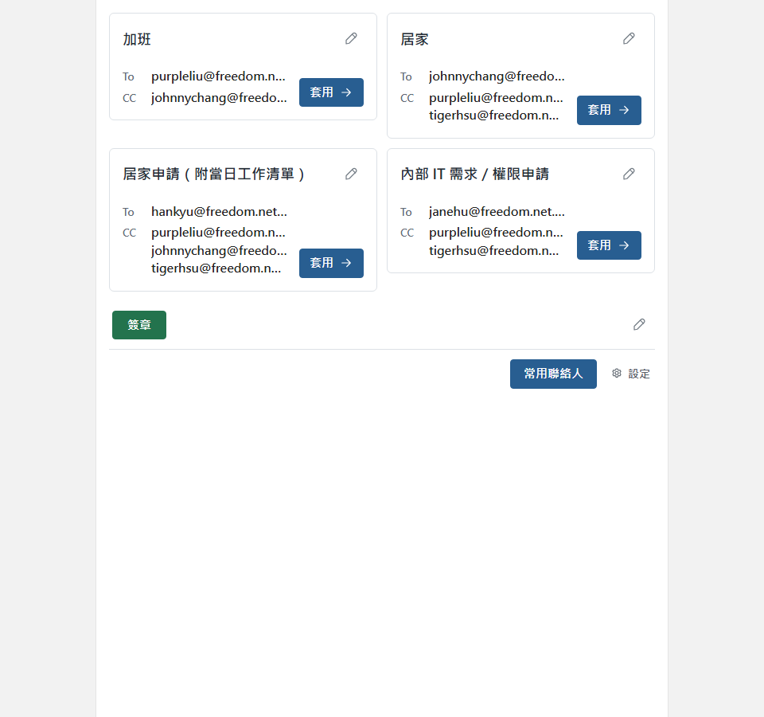

這些是模擬 Office 的自動化驗證，尚未在真正 Outlook 完成本次實機驗收。manifest 未修改；本次未重新側載或寄信。

## 公司固定範本整合（2026-11-14，歷史版本）

新增四個公司固定範本、欄位表單、隔離即時預覽及獨立草稿追蹤；現有自訂模式與簽章保留。來源 HTML 不改寫，只替換 token 及展開工作列，外加無樣式追蹤 div。首次置頂、更新先確認、To／CC 附加及主旨保留／覆蓋／取消。

113 項單元／整合測試、19 項模擬 Office E2E、正式建置及既有 XML manifest 驗證通過。四份 HTTP 瀏覽器預覽的文字、格寬高與字型／配色已比對並截圖。這些不代表真實 Outlook 已驗收，舊版實機紀錄不能當作四個新範本的通過證據。

逐項驗收、八張對照截圖及部署步驟見 [公司範本驗收](COMPANY-TEMPLATES.md)。

自動化驗證日期：2026-11-14；桌面安裝確認：2026-11-14（Asia/Taipei）。目標為 Windows 新版 Microsoft Outlook 桌面應用程式。

## 已驗證

### 1.6 常用聯絡人、按鈕配色與簽章圖片（2026-11-14，歷史版本）

- 「常用地址」改成「常用聯絡人」，首頁入口藍底白字；簽章綠底白字，右側鉛筆仍可編輯。
- 使用者從 Outlook 複製簽章後圖片空白。確認程式先前只解析 src 中的 CID，未使用 originalsrc，並直接保存 HTTPS 圖片 URL；VML 圖片也可能被清理移除。原始剪貼簿 HTML 未取得，以上是已確認的程式缺口，不是對使用者實機根因的確診。
- 貼上與 Save 在清理前共用圖片解析：優先用原始 CID／附件 ID 讀取目前草稿圖片；支援舊 Outlook URL 精確 ID、VML 轉換與重複 fallback 去重。可讀取的公開圖片轉成 Base64 儲存；讀取失敗不插入殘缺內容。既有錯誤連結可在 Save 時重試解析；已失去來源的圖片需重貼。
- 89 項單元、15 項模擬 Office E2E 通過，包含 originalsrc 解析、VML、舊 URL、模糊 ID 拒絕、無效來源提示、圖片實際解碼成功、Save／重載保留，以及加到草稿時採內嵌資料。建置、manifest 1.6.0.0、HTTPS 檢查通過。
- 真實 Outlook 原始案例仍待重新貼上確認；測試未對使用者草稿寄信或寫入。

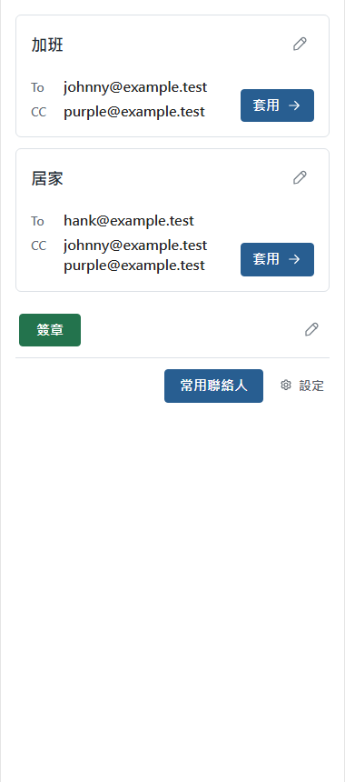

### 1.5 每人一欄、常用地址與橘色信封（2026-11-14，歷史版本）

- To／CC 的「＋」可新增一人並聚焦 Email，或選常用地址；× 移除。首頁及＋選單可管理常用姓名／Email，常用姓名可留空；選取為獨立副本，之後修改／刪除常用不連動模式。
- 82 項單元測試、13 項模擬 Office E2E 通過。新增驗證常用列表有效性／去重、舊 v2 相容、多人新增與刪除、選取常用、Escape 與鍵盤焦點、保存重開、常用修改／刪除不改已存模式、編輯中往返常用保留未存內容、多行貼上拆列。既有草稿、模板與簽章保護測試仍通過。
- 使用內建 image_gen 與畫廊 #221 參考圖生成橘色毛氈信封，檢查原圖及 48px 圖示。產生六種尺寸，manifest 1.5.0.0 與 favicon 改用新 mail-felt URL；建置、manifest、HTTPS 驗證通過。
- 官方 CLI 已成功將相同 AppId 更新登記為 1.5.0.0。自動化畫面與操作為模擬主機，不代表真實 Outlook 操作驗收；宿主圖示快取刷新仍需實機確認。

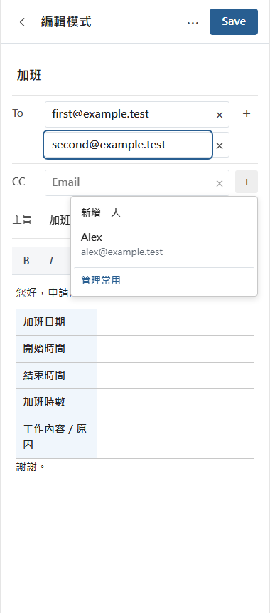

### 1.4 直接輸入 Email（2026-11-14，歷史版本）

- 移除模式與簽章的裝飾圖示、首頁主旨小字；保留黑白插畫 app Logo。模式名稱可直接輸入；To／CC 改成自動增高的文字欄位，接受分號、逗號及換行，不使用共用聯絡人或重新命名步驟。
- Settings v2 直接保存地址；舊版參照從原本帳號 key／備份轉換，Save 才覆寫。驗證空白舊 CC 不會被默默省略、無效 ID 拒絕載入、模式內容和簽章保留，以及並行儲存衝突仍會阻擋覆寫。
- 80 項單元測試與 11 項模擬 Office E2E 通過，包含直接輸入、無效地址保留編輯、分隔符號、多地址去重、清空 CC、Save 後重載、同 ID 舊備份匯入刷新欄位、模板與簽章保護。320／960px 編輯頁無水平溢出。
- 型別檢查／建置、manifest 1.4.0.0 驗證、本機 HTTPS 資源檢查通過，官方 CLI 已成功更新登記同一 AppId。模擬驗證不等於真實 Outlook 收件者操作驗收。

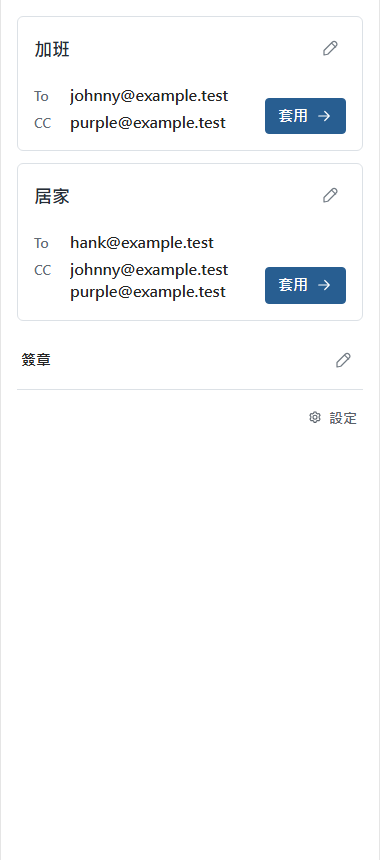

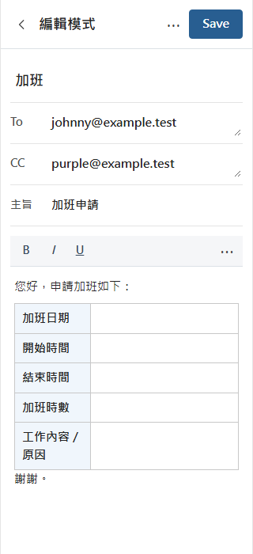

### 1.3 指定插畫與局部配色（2026-11-14，歷史版本）

- 使用使用者提供的黑白溫室插畫，等比例輸出六種圖示尺寸；manifest 1.3.0.0 改用新的 illustration 圖示網址。相同 AppId 已由官方 CLI 成功更新登記，HTTPS 新資源及 manifest 驗證通過；尚未目視確認 Outlook 宿主圖示刷新。
- 白色細框卡片，只有小圖示帶淡色，套用按鈕統一深藍；收件者與套用並排。寬窗格雙欄、窄窗格直排，移除整片彩色底與簽章色帶。
- 9 項模擬 Office E2E、型別檢查／建置通過。另以模擬主機檢查 320、600、668px 列表無水平溢出並截圖；320／960px 編輯頁既有 E2E 通過。瀏覽器實際標題字型確認為 Microsoft JhengHei UI Bold。這些不代表真實 Outlook 草稿操作驗收。

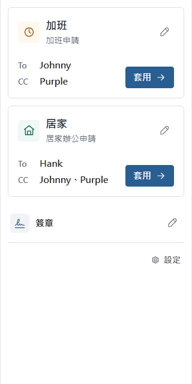

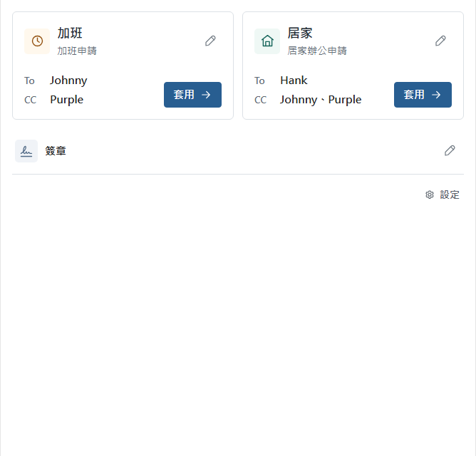

### 1.2 Logo、標題與配色（2026-11-14，歷史版本）

- 使用畫廊 #062 參考圖生成幾何老虎 Logo；檢查原圖與 48px 實際圖示，衍生 16／32／48／64／80／128px PNG。
- 移除 app 首頁自己的整列 Logo／標題，設定移至列表底部。Outlook 的宿主增益集標籤仍保留，不將其宣稱為可由 app 隱藏。
- 加班琥珀色、居家綠色、自訂模式藍色、簽章紫色；名稱和按鈕文字仍提供功能辨識。編輯器模式選擇與收件者欄位加入淡色，沒有恢復玻璃效果或漸層。
- 9 項模擬 Office E2E、型別檢查／建置、manifest 驗證和本機 HTTPS 資源檢查通過。相同 AppId 的 manifest 1.2.0.0 由官方 CLI 登記成功；Outlook 桌面實際圖示快取刷新仍待使用者確認。

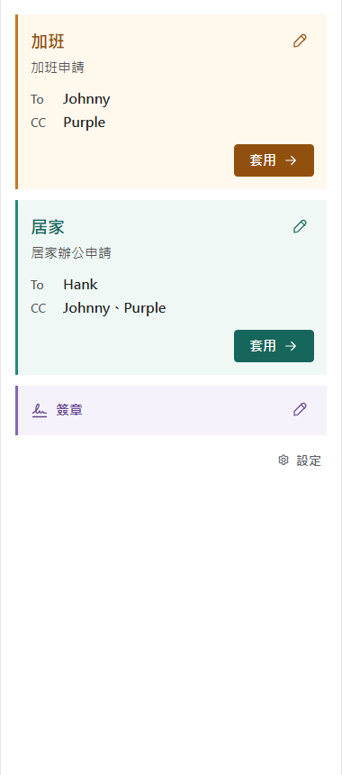

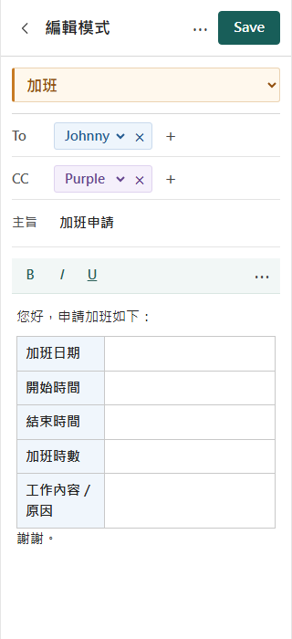

### 編輯介面重做（2026-11-14，前次版本）

使用者否定 iOS 介面後，移除玻璃、漸層及膠囊樣式，改為白底郵件編輯器。常用欄位為模式選擇、To／CC、主旨與內文；聯絡人另頁編輯，名稱僅新增／重新命名時顯示。備份、刪除與進階格式收進各自的「⋯」。下方的 1.1 圖片保留作歷史紀錄，不代表目前介面。

- 型別檢查、建置、HTTPS 資源檢查通過，9 項 Playwright 模擬 Office 測試通過。
- 驗證選單 Escape、聯絡人／模式切換保留未存內容、重新命名、Save 返回、表格工具、簽章與草稿保護流程。
- 已檢查 320px／960px 畫面，無整頁橫向溢出。格線為編輯區的 CSS 輔助，不改動已儲存模板及 Outlook 原稿。
- 本次無需修改 manifest；重開面板即可載入新介面。新版尚未由使用者完成 Outlook 桌面驗收。

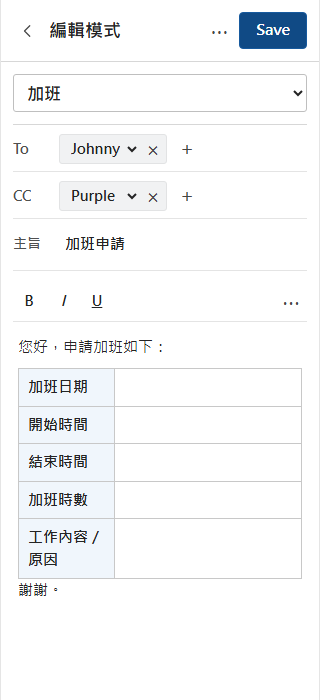

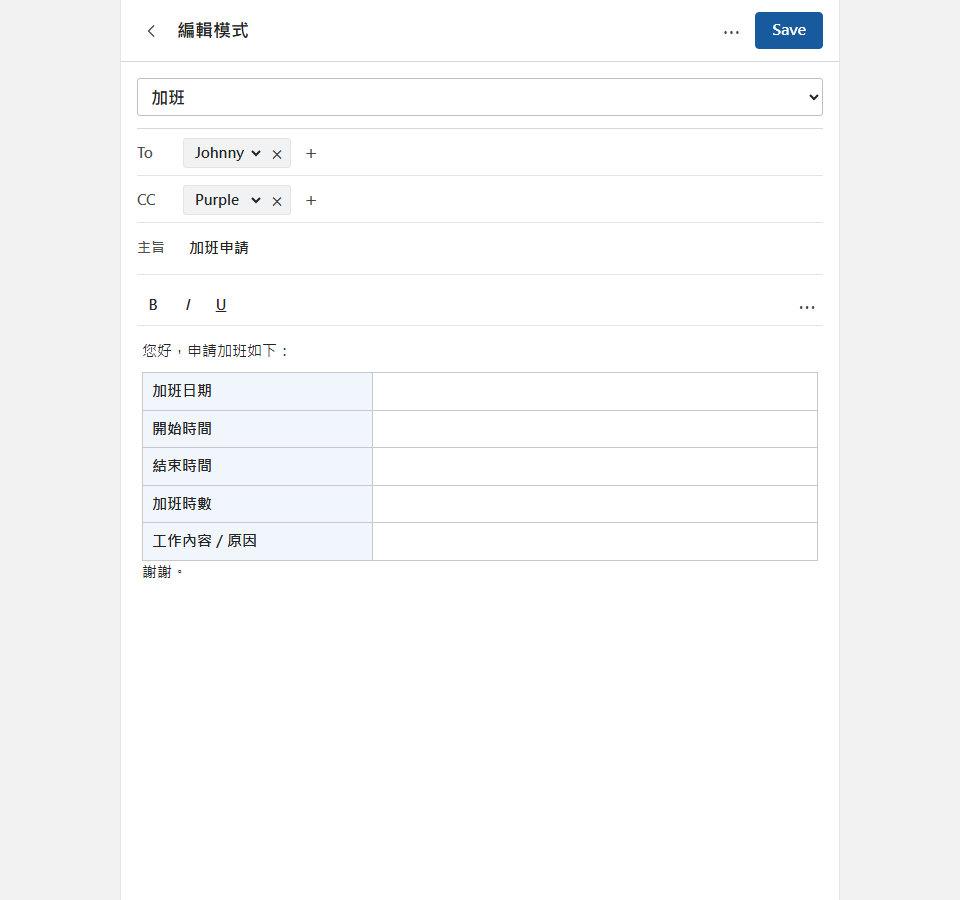

### 1.1 版更新（2026-11-14）

- 小老虎圖示與 manifest 1.1.0.0 已完成，官方 CLI 重新登記成功（相同 AppId）。本機 HTTPS 3443 持續運作，資源與 TLS 檢查通過。
- 依使用者追加要求移除背景光暈及常駐提示；主要資訊改為 15px、較深且偏粗的文字，淡玻璃效果僅保留於按鈕。Save 儲存成功返回首頁，失敗保留編輯內容。
- 新增空白簽章容器：貼上 HTML、文字、連結、圖片與圖片檔案；相同草稿的 CID 圖片可透過 Office.js 解析。簽章設定相容舊版 JSON，不修改既有模式預設。
- 簽章加入使用獨立的 prepared/applied 自訂屬性與內嵌圖片附件；與模板共用操作鎖。插入最底部前後驗證原稿、欄位、圖片及連結，失敗或標記遺失停止重複加入。
- 單元測試 78 項、Playwright 模擬主機測試 8 項、型別檢查／正式建置與 manifest 驗證通過。測試包含 Save 失敗、簽章重開持久性、未存變更、連結／圖片、模板切換後保留簽章、重複與中斷操作、320px 溢出檢查。
- 已目視檢查新版列表、編輯頁及簽章頁截圖。以下均為 **模擬 Office 主機**，不代表新版 Outlook 桌面圖片／剪貼簿或工具列釘選已實測。使用者先前回覆成功套用，只作為前一版模式功能的實機證據。

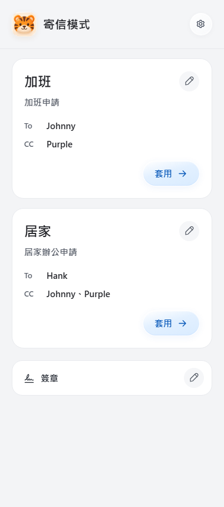

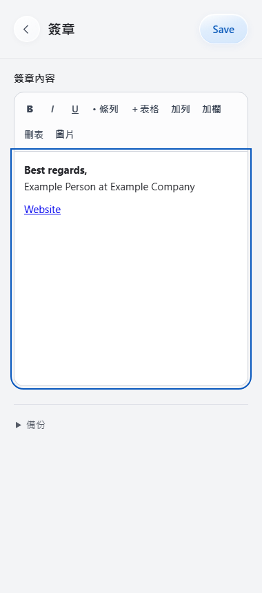

### 檢查結果

| 項目 | 結果與範圍 |
| --- | --- |
| `npm run typecheck` | 通過，TypeScript strict。 |
| `npm test` | **78 / 78 通過**（1.1 版），6 個測試檔；測試使用 FakeDraft / 模擬 Office.js callback。 |
| `npm run test:e2e` | **9 / 9 通過**，Playwright Chromium；透過測試注入的 Office 主機模擬執行真正工作窗格程式，非 Outlook 實機。 |
| `npm run build` | 通過，完整靜態產物位於 `dist/`，含工作窗格、commands/support 頁與 PNG 圖示。 |
| `npm run validate:manifest` | Microsoft `office-addin-manifest` 工具通過 XML schema、命令／需求宣告與 HTTPS URL 格式驗證。這不代表已側載。 |
| `npm start` | 已實際在 `https://localhost:3443` 啟動 Vite HTTPS 開發伺服器。3000 埠被既有程式占用，因此專案與 manifest 統一使用 3443。 |
| `npm run verify:https` | 工作窗格、commands、support 與 5 個圖示皆取得 HTTP 200；使用生成的開發 CA 驗證 TLS，沒有停用 TLS 驗證。此檢查**不代表 Windows 已信任 CA**。 |
| Windows 開發憑證信任 | 後續安裝作業已將現有開發 CA 匯入 `Cert:\CurrentUser\Root`；`npm run certs:verify` 顯示 `You have trusted access to https://localhost.`，Edge 可直接載入工作窗格，沒有憑證警告。 |
| 官方 CLI 側載 | 使用 Microsoft 365 Agents Toolkit 1.1.19 `atk install --xml-path manifest.xml --interactive false` 成功，回傳與 manifest 一致的 AppId。實際 Outlook 的「應用程式」清單已顯示「寄信模式」。 |
| 實際 Outlook 網頁版啟動 | 在已登入信箱的新建空白草稿中，成功開啟 `Office 增益集 寄信模式` iframe（`https://localhost:3443/taskpane.html`），呈現加班／居家／管理模式，未顯示 Office 初始化錯誤。這是實際 Office 主機，不是模擬或獨立網站預覽；但**不等同 Windows 桌面版驗收**。 |
| Windows 新版 Outlook 桌面啟動 | 2026-11-14 使用者確認並提供截圖：關閉整個 Outlook 後重新啟動，從「訊息」→ 四格「應用程式」→「寄信模式」成功開啟右側面板。側載前持續執行的桌面程序原本沒有更新清單。 |
| 桌面未設定地址的狀態 | 設定前使用者截圖顯示加班缺 Johnny／Purple、居家缺 Hank／Johnny／Purple，兩個套用按鈕均停用。 |
| 桌面加班模式套用 | 2026-11-14 使用者載入標記相容性修正版後，以新草稿套用加班，回覆「全部已成功帶入」，確認 To、CC、主旨及表格。此確認不包含後續儲存格編輯、切換模式或重開後持久性。 |
| `npm audit --omit=dev` | 查閱時 production dependencies 0 個已知漏洞。 |
| 不自動寄送 | 原始碼沒有傳送 API、on-send 事件、Graph 或 EWS 呼叫；E2E 的 send spy 為 0。 |

### 自動測試涵蓋的行為

- 預設只有 Johnny、Purple、Hank 姓名，Email 留空；缺少必要 Email 時列出姓名並阻止套用。
- 三人填妥後共用於兩個模式。加班使用 Johnny / CC Purple，居家使用 Hank / CC Johnny、Purple。
- 大小寫與前後空白處理、同欄地址去重、To 優先於 CC；完整名單替換，清空 CC 使用空陣列。
- 初次套用插入可編輯 HTML 表格，保留模擬草稿原本的簽名、CID 圖片和回覆歷史。
- 再次套用相同模板保留已填的儲存格；切換模式顯示影響範圍與原模板文字，取消不寫入。
- 更換模板只切換追蹤區域，區域外的 HTML 原始字串不經重建／清理；另以回讀文字、圖片、連結與表格結構驗證內容。
- 宿主吞掉原有簽名或圖片、標記遺失／重複／破損、非同步失敗、存檔失敗、JSON `null`、純文字草稿會回報錯誤或部分完成。
- 確認期間編輯草稿會停止後續套用；連點不會並行寫入；15 秒 callback 逾時會隔離同一草稿，遲到 callback 不會變成成功。
- 釘選窗格 `ItemChanged` 後，舊草稿 port 失效；新草稿可重新判斷。正文讀寫使用一致的 `HostConfig`。
- 新增、修改、刪除模式，新增／替換／移除多人收件者；編輯 HTML、文字格式、表格及新增列。
- 管理頁儲存後重新載入保留設定；修改草稿不會回寫模式預設。localStorage 損壞、容量錯誤與其他窗格儲存衝突不會被誤報成功。
- 320px 寬工作窗格無整頁橫向溢出；已目視檢查模式列表和管理頁測試截圖。

測試地址僅出現在測試檔，使用保留的 `example.test` 網域。應用程式預設設定沒有任何假造收件者地址。

## 需要你在 Outlook 中驗證

後續安裝作業已完成憑證信任、信箱側載及實際 Outlook 網頁版啟動。2026-11-14 使用者已確認並以截圖證實 **Windows 新版 Outlook 桌面面板成功開啟**。先前 5 項 Playwright E2E 仍屬模擬 Office API 測試；桌面草稿欄位與內文套用、持久儲存等行為仍須進行下列實機驗收。

1. **Windows 憑證信任已完成。**後續安裝作業已匯入既有開發 CA，且官方工具回報 localhost 受信任。將來換電腦或憑證過期時，仍須重新完成信任步驟；不能只根據工具 exit code 判斷成功。
2. 側載、桌面入口及右側面板已確認；帳號支援時的釘選與草稿切換行為仍待驗證。
3. 填入實際 Email，驗證兩個模式的 To / CC、主旨、加班及居家表格；直接在 Outlook 編輯儲存格，確認它不是圖片。
4. 以真實簽名（包括圖片／連結）、回覆與轉寄，檢查 HTML 排版、內容保留、HostConfig 在對話／個別郵件設定下的行為，以及模板標記是否被宿主保留。
5. 關閉／重開面板、關閉／重開 Outlook，再開啟同一草稿與新草稿，驗證本機設定持久性及草稿自訂屬性的追蹤。
6. 完成 [實機驗收表](OUTLOOK-ACCEPTANCE.md)。最後仍由你自行按 Outlook 的「傳送」；驗收無需寄出測試信。

實際 Outlook 網頁版啟動證據（只截取增益集面板，不包含信箱郵件內容）：

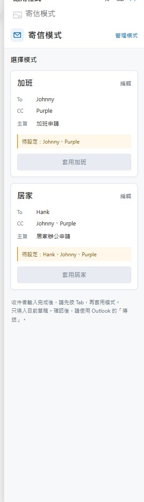

## 已知邊界

2026-11-14 桌面使用者回報：表格已插入，但回讀時模板標記無法辨識，因此 To、CC、主旨未寫入。已將單一精確 id 比對改為支援 `x_` 前綴與相同草稿 token 的備援 class，仍要求唯一且完整的 div 邊界，遺失或重複時停止。新增模擬回讀正規化測試，驗證完整欄位套用、已填內容保留、取消與切換模式；55 項單元測試、5 項 E2E 及建置通過。使用者隨後確認修正版已在桌面新草稿成功帶入 To、CC、主旨及表格；未取得原始回傳 HTML，因此不斷言具體由哪個屬性改寫造成。

- Office.js 只能讀到已解析的收件者，請先按 Tab 完成輸入，再套用。
- Office 沒有跨欄位原子交易或編輯鎖；套用時請暫停手動修改。回讀發現變更時會停止並如實顯示部分完成，無法自動撤銷已完成的 Office 寫入。
- 回讀檢查保護文字／圖片／連結／表格結構，不能取代外觀驗收。若宿主改寫後標記無法辨識，會停止替換，提示保留原稿並使用新草稿。
- 模式存在當前信箱、origin 與 Outlook WebView 的本機儲存空間，不隨信箱同步。更換電腦／origin 或重設 WebView 前請匯出編輯副本。
- 開發伺服器關閉後不能載入增益集；正式使用需部署 `dist/` 至持續可用的 HTTPS 靜態主機。本次沒有部署到正式網域。
